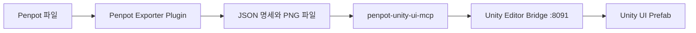

# Penpot → Unity UI MCP 사용 설명서

Penpot의 UI 프레임을 Unity uGUI 프리팹으로 옮기는 로컬 자동화 도구입니다. Penpot 플러그인은 UI 구조와 PNG 에셋 정보를 내보내고, MCP 서버는 Unity Editor 브리지에 요청해 프리팹을 생성하거나 수정합니다.

## 구성



| 구성 요소 | 위치 | 역할 |
| --- | --- | --- |
| Unity Bridge | `Assets/PenpotUnityUiMcp` | Unity Editor에서 안전한 UI 작업 실행 |
| MCP Server | `Tools/penpot-unity-ui-mcp` | Codex, Claude Desktop 같은 MCP 클라이언트와 Bridge 연결 |
| Penpot Exporter | `Tools/penpot-unity-exporter-plugin` | Penpot 구조와 PNG 에셋을 로컬 파일로 내보냄 |

## 빠른 시작

### 1. Unity Bridge 설치와 연결

1. `Assets/PenpotUnityUiMcp` 폴더를 Unity 프로젝트의 `Assets` 아래에 둡니다.
2. Unity 컴파일이 끝날 때까지 기다립니다.
3. **Tools > Penpot Unity UI MCP** 창을 엽니다.
4. **Connect**를 누릅니다.

정상 연결 주소는 `http://127.0.0.1:8091/`입니다. Bridge 창을 닫아도 연결은 유지됩니다. Disconnect는 Bridge만 중지하며 프리팹이나 에셋을 지우지 않습니다.

### 2. MCP 서버 등록

MCP 서버 폴더에서 의존성을 설치합니다.

```bash
cd Tools/penpot-unity-ui-mcp
npm install
```

MCP 클라이언트 설정에 다음을 추가합니다. 로컬 개발 중에는 전역 설치 대신 `node`와 절대 경로를 사용합니다.

```json
{
  "mcpServers": {
    "penpot-unity-ui": {
      "command": "node",
      "args": ["/absolute/path/to/Tools/penpot-unity-ui-mcp/src/index.mjs"],
      "env": {
        "PENPOT_UNITY_UI_BRIDGE_URL": "http://127.0.0.1:8091"
      }
    }
  }
}
```

설정 변경 뒤에는 MCP 클라이언트를 다시 로드합니다. Unity Bridge가 연결되지 않았다면 MCP 도구는 명확한 연결 오류를 반환합니다.

### 3. Penpot Exporter 설치

Exporter 폴더에서 정적 파일을 제공합니다.

```bash
cd Tools/penpot-unity-exporter-plugin
npm install
npm run build
npx serve public -l 4400
```

Penpot의 **Plugin Manager**에서 다음 주소를 설치합니다.

```text
http://localhost:4400/manifest.json
```

플러그인을 실행하고 **Download JSON and PNG assets**를 누릅니다. 선택이나 Export preset 설정은 필요 없습니다. 플러그인은 모든 페이지를 순회해 채움·선·이미지가 있는 비텍스트 레이어를 PNG로 내보냅니다.

동일한 시각 레이어는 PNG 하나만 만들며 JSON의 `assets[].sourceIds`에 해당 Penpot 노드 ID를 모두 기록합니다. 텍스트는 PNG가 아니라 Unity TMP 텍스트로 변환할 수 있도록 JSON에 보존됩니다.

## 기본 작업 흐름

1. `penpot_load_export`로 내려받은 JSON을 읽습니다.
2. `penpot_build_unity_ui_plan`으로 대상 프레임의 Unity UI 계획을 만듭니다.
3. 내려받은 PNG를 `unity_ui_copy_penpot_asset`로 `Assets/PenpotUI/Images/` 아래로 복사합니다.
4. `unity_ui_create_prefab`으로 프리팹을 만듭니다. 기존 경로를 덮어쓰지 않습니다.
5. `unity_ui_apply_plan`으로 Panel, Image, Button, TMP Text를 생성합니다.
6. `unity_ui_configure_image`로 Sprite 또는 9-slice를 연결합니다.
7. 필요에 따라 TMP 스타일, Layout Group, Button/Toggle/Slider/ScrollRect를 설정합니다.
8. `unity_ui_validate_prefab`으로 생성 결과를 검사합니다.
9. Game View 캡처와 Penpot 프레임 PNG를 비교합니다.

## Penpot 요소와 Unity 요소의 대응

| Penpot 요소 | Unity 생성 대상 |
| --- | --- |
| Frame / Group | RectTransform 계층 |
| 텍스트 | TextMeshProUGUI |
| 색상 사각형 | Image 또는 Panel |
| PNG로 내보낸 레이어 | Sprite가 설정된 Image |
| 반복 슬롯 | Button + Image |
| 세로·가로 Auto Layout | Vertical / Horizontal Layout Group |
| 격자 Auto Layout | Grid Layout Group |

Penpot 좌상단 좌표는 Unity 프리팹 중심 좌표계로 변환됩니다. 프레임 크기는 Canvas Scaler의 기준 해상도로 사용할 수 있습니다.

## Storage Box 예시

`Storage Box`를 다시 생성할 때 기존 프리팹이 `StorageBox.prefab`이면 새 프리팹 경로는 `Assets/PenpotUI/Prefabs/StorageBox_01.prefab`을 사용합니다.

1. Penpot의 `Storage Slot` 하나를 PNG로 내보냅니다.
2. `Assets/PenpotUI/Images/StorageSlot.png`으로 가져와 Sprite로 설정합니다.
3. 18개 슬롯에 같은 Sprite를 연결합니다.
4. 각 슬롯에는 `Button`과 ColorTint 상태를 설정합니다.

이 방식은 동일 이미지의 중복 파일을 만들지 않습니다.

## 검증과 시각 비교

`unity_ui_validate_prefab`은 다음을 검사합니다.

- 누락되거나 깨진 에셋·컴포넌트 참조
- 루트 프리팹 범위를 완전히 벗어난 RectTransform
- 같은 부모 아래의 중복 이름
- 잘못된 Grid Layout 설정
- 활성 Scene의 Canvas, Canvas Scaler, Graphic Raycaster, EventSystem 누락

`unity_ui_wait_for_compile`은 Unity 컴파일 종료와 Console의 Error, Exception, Assert를 확인합니다. `unity_ui_capture_game_view`와 `unity_ui_wait_for_capture`로 Game View PNG가 완성된 뒤, `penpot_compare_unity_screenshot`으로 Penpot 이미지와 비교합니다. `penpot_find_visual_mismatches`는 큰 차이가 있는 영역과 겹치는 Penpot 노드 ID를 반환합니다.

## 문제 해결

| 증상 | 해결 |
| --- | --- |
| Bridge 연결 실패 | Unity가 컴파일을 끝낸 뒤 Disconnect 후 Connect를 누릅니다. 포트 `8091`을 다른 프로그램이 사용 중인지 확인합니다. |
| MCP 도구가 Bridge를 찾지 못함 | MCP 설정의 `PENPOT_UNITY_UI_BRIDGE_URL`이 `http://127.0.0.1:8091`인지 확인하고 MCP 클라이언트를 다시 로드합니다. |
| PNG가 Unity에서 Texture로 보임 | `unity_ui_import_sprite` 또는 `unity_ui_copy_penpot_asset`을 사용해 Sprite Import를 적용합니다. |
| 화면 모양이 Penpot과 다름 | 같은 해상도로 Penpot 프레임과 Game View를 캡처한 뒤 시각 비교 도구를 실행합니다. |
| 생성 뒤 Console 오류 발생 | `unity_ui_wait_for_compile`의 반환 오류와 Unity Console의 `[Penpot Unity UI MCP]` 로그를 함께 확인합니다. |

## 안전 범위

Bridge는 로컬 주소만 사용합니다. UI 프리팹과 `Assets/PenpotUI/` 아래 에셋만 대상으로 하며, 기존 파일을 덮어쓰는 작업은 명시적으로 요청된 경우에만 수행합니다.
