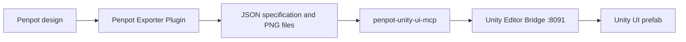

# Penpot → Unity UI MCP Guide

Penpot → Unity UI MCP converts Penpot UI designs into Unity uGUI prefabs through a local workflow. The Penpot plugin exports the design structure and PNG assets, while the MCP server asks the Unity Editor bridge to create and update UI prefabs.

## Architecture



| Component | Location | Purpose |
| --- | --- | --- |
| Unity Bridge | `Assets/PenpotUnityUiMcp` | Executes restricted UI operations inside the Unity Editor. |
| MCP Server | `Tools/penpot-unity-ui-mcp` | Connects an MCP client such as Codex or Claude Desktop to the Unity Bridge. |
| Penpot Exporter | `Tools/penpot-unity-exporter-plugin` | Downloads Penpot structure and PNG assets as local files. |

## Quick start

### 1. Connect the Unity Bridge

1. Place `Assets/PenpotUnityUiMcp` inside your Unity project's `Assets` folder.
2. Wait for Unity to finish compiling.
3. Open **Tools > Penpot Unity UI MCP**.
4. Select **Connect**.

The bridge listens only on `http://127.0.0.1:8091/`. It remains connected after its window is closed. Disconnect stops the bridge only; it does not delete UI prefabs or assets.

### 2. Register the MCP server

Install server dependencies:

```bash
cd Tools/penpot-unity-ui-mcp
npm install
```

For local development, add this to the MCP client configuration. Replace the sample path with the absolute path on your machine.

```json
{
  "mcpServers": {
    "penpot-unity-ui": {
      "command": "node",
      "args": ["/absolute/path/to/Tools/penpot-unity-ui-mcp/src/index.mjs"],
      "env": {
        "PENPOT_UNITY_UI_BRIDGE_URL": "http://127.0.0.1:8091"
      }
    }
  }
}
```

Reload the MCP client after changing its configuration. If the Unity Bridge is disconnected, the MCP tools return a connection error with the next action to take.

### 3. Install and run the Penpot Exporter

Serve the plugin locally:

```bash
cd Tools/penpot-unity-exporter-plugin
npm install
npm run build
npx serve public -l 4400
```

In Penpot, open **Plugin Manager** and install:

```text
http://localhost:4400/manifest.json
```

Run the plugin and select **Download JSON and PNG assets**. No layer selection or Penpot export preset is required. The plugin traverses every page and exports painted non-text layers, including backgrounds, cells, dividers, and outlines, as PNG files.

Identical visual layers share one PNG. Every Penpot node that uses that PNG is recorded in `assets[].sourceIds`. Text remains structured data so it can become a Unity TMP text component instead of a raster image.

## Components, responsive constraints, and PNG fallback

The exporter records Component and Variant metadata when Penpot exposes it, including a component ID, variant ID, variant name, and variant properties. Use `penpot_get_reusable_ui_assets` before generation to inspect reusable instances and state variants. Use `penpot_build_component_prefab_plan` with a Component or Variant root ID to create one Unity prefab for a reusable Penpot component, then use its Variant metadata to assign Button normal, highlighted, pressed, and disabled states.

Each exported shape also contains horizontal and vertical constraints. `penpot_build_unity_ui_plan` converts them into Unity anchor, pivot, anchored-position, and size values. When calling `unity_ui_apply_plan`, set `useResponsiveRect: true` and pass the plan's anchor and pivot values to preserve left, right, top, bottom, center, and stretch behavior at different resolutions.

Simple solid-color layers remain Unity-native Images. The exporter creates PNG fallback assets only for layers that Unity Image cannot faithfully represent: image or gradient fills, strokes, rounded corners, complex vectors, multiple fills, blur, and non-normal blend modes. Each fallback node has `fallbackAssetFileName` and `fallbackReason`. Use `penpot_import_exported_assets` with the download directory to copy every fallback PNG into `Assets/PenpotUI/` and import them as Sprites, then assign a Sprite through `unity_ui_configure_image`.

## Generation workflow

1. Read the downloaded JSON using `penpot_load_export`.
2. Build a plan for the target frame with `penpot_build_unity_ui_plan`.
3. Copy each PNG into `Assets/PenpotUI/Images/` with `unity_ui_copy_penpot_asset`.
4. Create a prefab with `unity_ui_create_prefab`. Existing prefabs are never overwritten.
5. Add hierarchy elements with `unity_ui_apply_plan`.
6. Assign sprites or 9-slice settings with `unity_ui_configure_image`.
7. Configure TMP text, Layout Groups, and controls such as Button, Toggle, Slider, ScrollRect, and Input Field as needed.
8. Run `unity_ui_validate_prefab`.
9. Capture the Game View and compare it with a Penpot frame export.

## Idempotent updates, Auto Layout, and accessibility

Use `penpot_build_unity_apply_actions` to produce `upsert` actions for `unity_ui_apply_plan`. Each action carries the Penpot source ID. Unity stores that ID in `PenpotUnityUiMetadata`, so running the same export again updates the matching object instead of creating another copy.

The generated actions also preserve Penpot Component and Instance IDs. Use `penpot_get_reusable_ui_assets` to find repeated component instances and `penpot_build_component_prefab_plan` to build their shared Unity prefab template.

Penpot Auto Layout is carried as layout type, padding, gap, alignment, wrap, and grow data. Generated actions configure Horizontal, Vertical, or Grid Layout Groups and map grow to Unity's child force-expand settings. Every generated object stores its Penpot name as an accessibility label and preserves a Penpot description as accessibility metadata for test automation or an accessibility integration.

## Penpot-to-Unity mapping

| Penpot | Unity |
| --- | --- |
| Frame or group | RectTransform hierarchy |
| Text | TextMeshProUGUI |
| Colored rectangle | Image or Panel |
| Exported PNG layer | Image with a Sprite |
| Repeated slot | Button with an Image |
| Horizontal or vertical Auto Layout | Horizontal or Vertical Layout Group |
| Grid Auto Layout | Grid Layout Group |

Penpot's top-left coordinate system is converted to centered Unity RectTransform coordinates. A frame's dimensions can become the Canvas Scaler reference resolution.

## Storage Box example

If `StorageBox.prefab` already exists, create the next version at `Assets/PenpotUI/Prefabs/StorageBox_01.prefab`.

1. Export one Penpot `Storage Slot` as PNG.
2. Import it as `Assets/PenpotUI/Images/StorageSlot.png`.
3. Assign that single Sprite to all 18 slot Buttons.
4. Add Button ColorTint states for normal, highlighted, pressed, and disabled interaction.

This reuses the same asset instead of producing 18 duplicate images.

## Validation and visual comparison

`unity_ui_validate_prefab` checks for:

- Broken asset or component references
- RectTransforms completely outside the prefab bounds
- Duplicate sibling names
- Invalid Grid Layout settings
- Missing Canvas, Canvas Scaler, Graphic Raycaster, or EventSystem in the active scene

Use `unity_ui_wait_for_compile` after operations that trigger script compilation. It waits for Unity to become idle and returns Error, Exception, and Assert logs. Use `unity_ui_capture_game_view` and `unity_ui_wait_for_capture` before `penpot_compare_unity_screenshot`. `penpot_find_visual_mismatches` maps major image differences back to overlapping Penpot node IDs.

## Troubleshooting

| Symptom | Resolution |
| --- | --- |
| Bridge does not connect | Wait for Unity compilation to finish, then select Disconnect and Connect. Check that port `8091` is available. |
| MCP cannot find the Bridge | Confirm `PENPOT_UNITY_UI_BRIDGE_URL` is `http://127.0.0.1:8091`, then reload the MCP client. |
| A PNG is imported as a Texture | Use `unity_ui_import_sprite` or `unity_ui_copy_penpot_asset` to apply Sprite import settings. |
| Unity differs from Penpot | Export and capture both images at the same resolution, then run the visual comparison tools. |
| Unity reports errors after generation | Review `unity_ui_wait_for_compile` output and Unity Console entries beginning with `[Penpot Unity UI MCP]`. |

## Safety boundary

The bridge accepts local connections only. It is limited to UI prefabs and assets under `Assets/PenpotUI/`; overwriting an existing file requires an explicit overwrite request.

For the Korean translation, see [PENPOT_UNITY_UI_MCP_GUIDE.ko.md](PENPOT_UNITY_UI_MCP_GUIDE.ko.md).
